# System Architecture & Technical Specifications

## 1. System Architecture Overview

The AIOps Platform operates as a closed-loop intelligent control plane for cloud-native Kubernetes environments.

```text
+-------------------------------------------------------------------------+
|                         OBSERVE & COLLECT                               |
|   Prometheus • kube-state-metrics • cAdvisor • Loki Logs • OpenTelemetry |
+-------------------------------------------------------------------------+
                                    │
                                    ▼
+-------------------------------------------------------------------------+
|                         FEATURE & DATA ENGINE                           |
|      Min-Max Normalization • Sliding Window Metrics • Event Pipelines   |
+-------------------------------------------------------------------------+
                                    │
                                    ▼
+-------------------------------------------------------------------------+
|                         INTELLIGENT ANALYSIS                            |
|  Isolation Forest (Anomaly) • Random Forest (Failure) • Fuzzy Risk |
+-------------------------------------------------------------------------+
                                    │
                                    ▼
+-------------------------------------------------------------------------+
|                     INVESTIGATION & EXPLANATION                         |
|   Hybrid RCA Engine • Runbook Retrieval (RAG) • SLM Assistant (demo template)|
+-------------------------------------------------------------------------+
                                    │
                                    ▼
+-------------------------------------------------------------------------+
|                         DECISION & SAFETY                               |
|        Prolog-style Declarative Policy Engine (ALLOW / DENY / APPROVE)        |
+-------------------------------------------------------------------------+
                                    │
                                    ▼
+-------------------------------------------------------------------------+
|                        REMEDIATION & RECOVERY                           |
|       Kubernetes API Scaling • Pod Restarts • Recovery Verification     |
+-------------------------------------------------------------------------+
```

---

## 2. Mermaid Diagrams Matrix

### Diagram 1: Overall System Architecture
```mermaid
graph TD
    K8s[Kubernetes Minikube Cluster] -->|Telemetry| Prom[Prometheus Collector]
    K8s -->|Logs| Loki[Loki Log Aggregator]
    
    Prom --> FastAPI[FastAPI Backend Core]
    Loki --> FastAPI
    
    subgraph AI/ML Engine
        FastAPI --> IF[Isolation Forest]
        FastAPI --> RF[Random Forest Predictor]
        FastAPI --> NF[Fuzzy Overload Risk]
    end
    
    subgraph RCA & SLM Assistant
        IF & RF --> RCA[Hybrid RCA Engine]
        RCA --> RAG[Runbook Store]
        RAG --> SLM[SLM Assistant (demo template)]
    end
    
    subgraph Safety & Execution
        SLM --> Policy[Prolog-style Policy Engine]
        Policy --> K8sExec[K8s Remediation Executor]
        K8sExec --> K8s
    end
    
    FastAPI -->|WebSockets| React[React Vite Dashboard]
```

### Diagram 2: Component Architecture
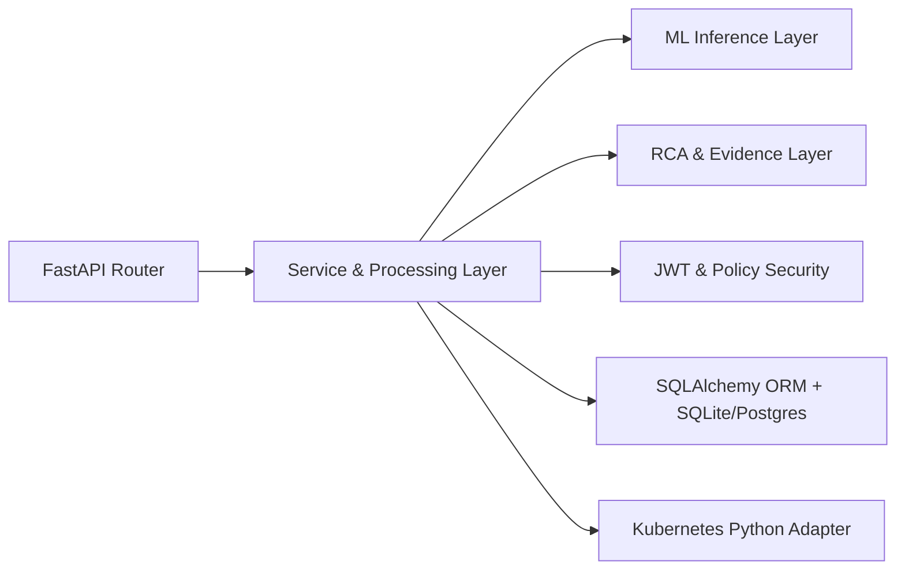

### Diagram 3: Deployment Architecture
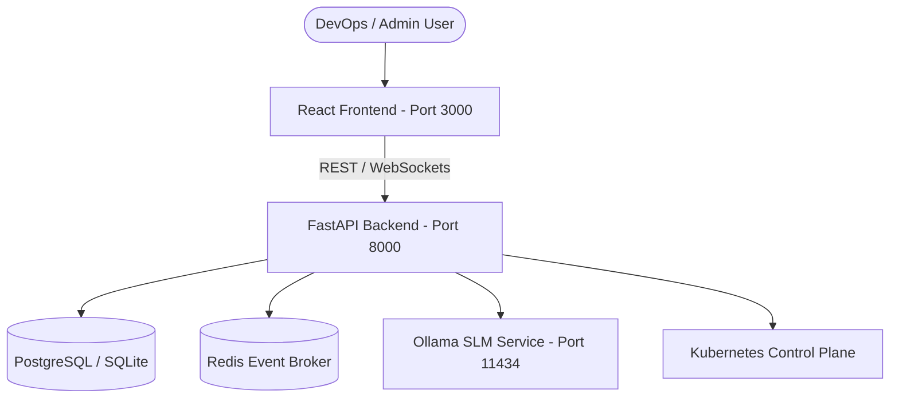

### Diagram 4: DFD Level 0 (Context Diagram)
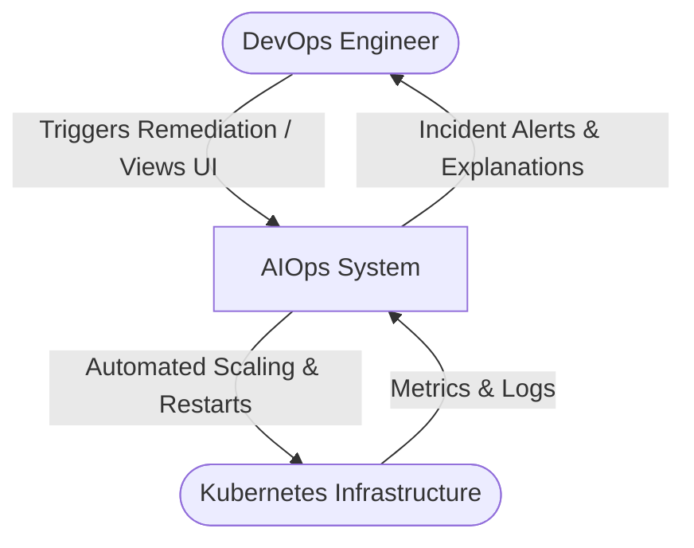

### Diagram 5: DFD Level 1 (Data Flow Diagram)
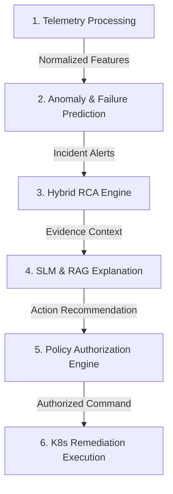

### Diagram 6: ML Pipeline Architecture
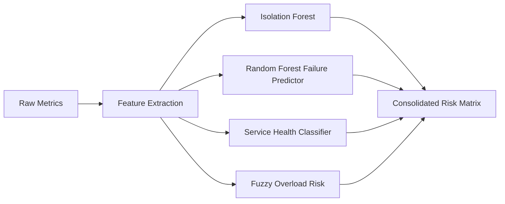

### Diagram 7: Root Cause Analysis (RCA) Workflow
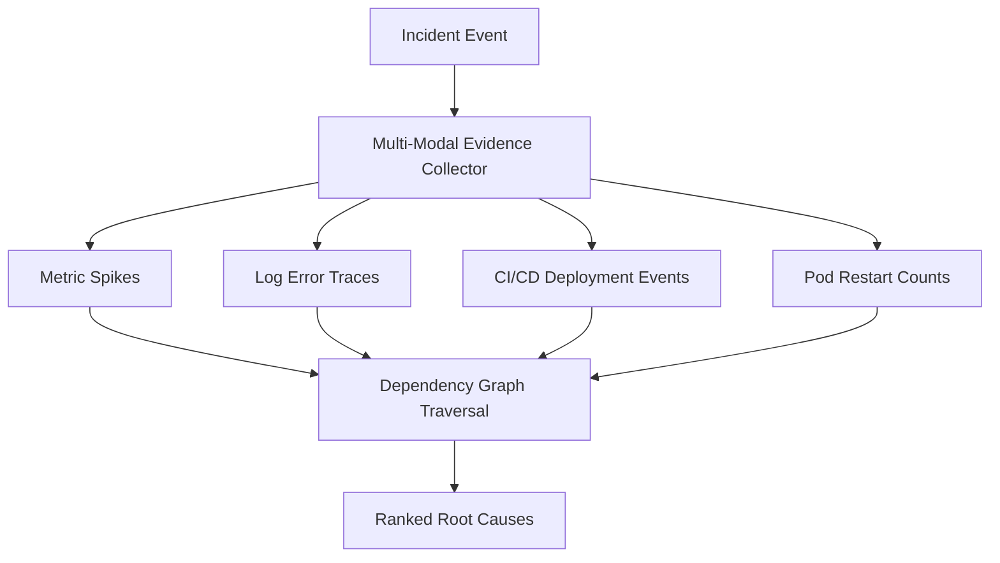

### Diagram 8: SLM & RAG Workflow
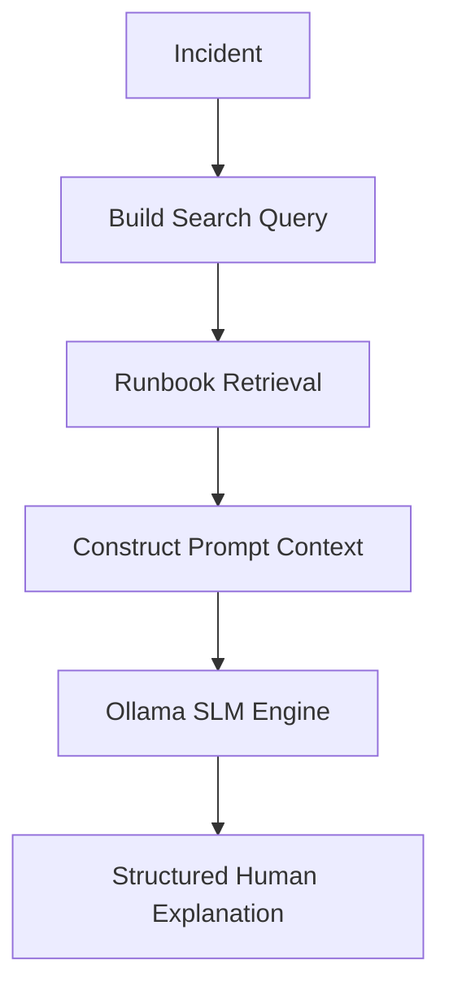

### Diagram 9: Kubernetes Monitoring Flow
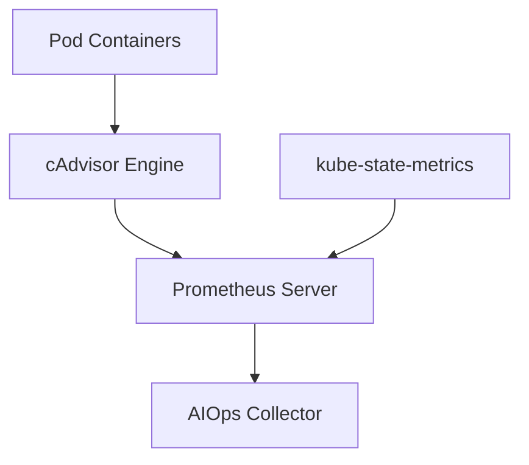

### Diagram 10: Self-Healing Lifecycle
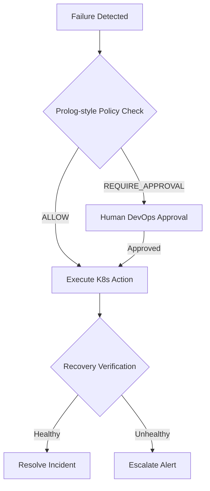

### Diagram 11: Predictive Auto-Scaling Workflow
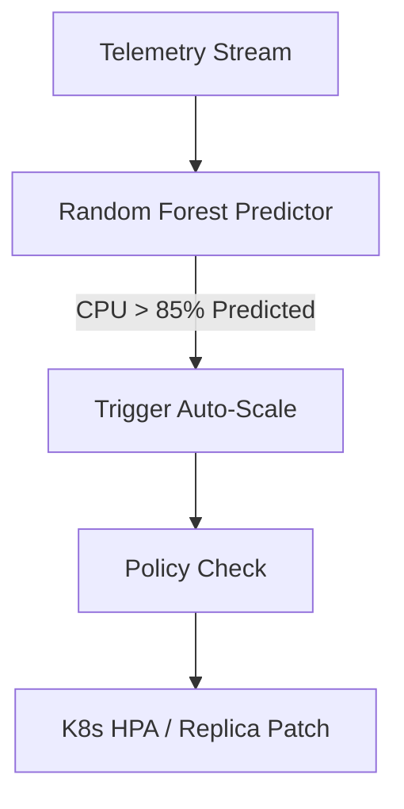

### Diagram 12: CI/CD Pipeline Failure Prediction
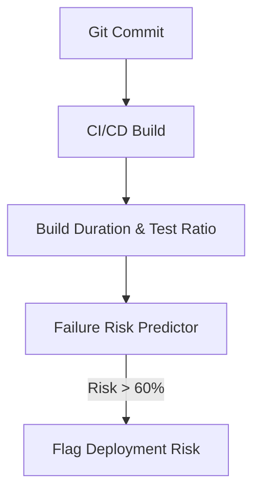

### Diagram 13: Cloud Cost Intelligence Workflow
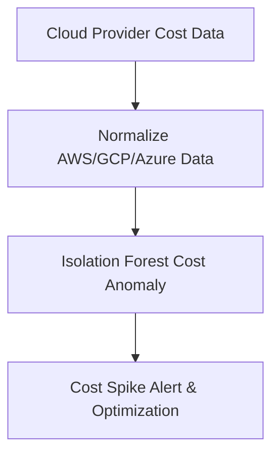

### Diagram 14: Authentication & Security Architecture
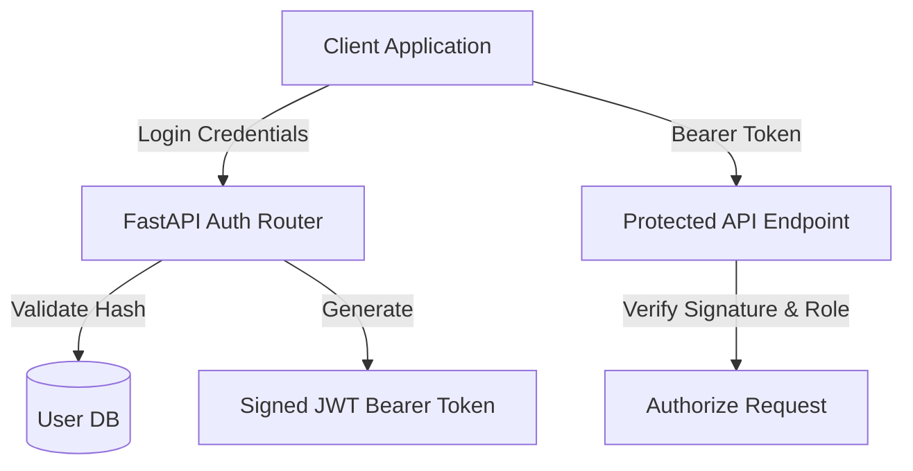

### Diagram 15: Entity Relationship (ER) Diagram
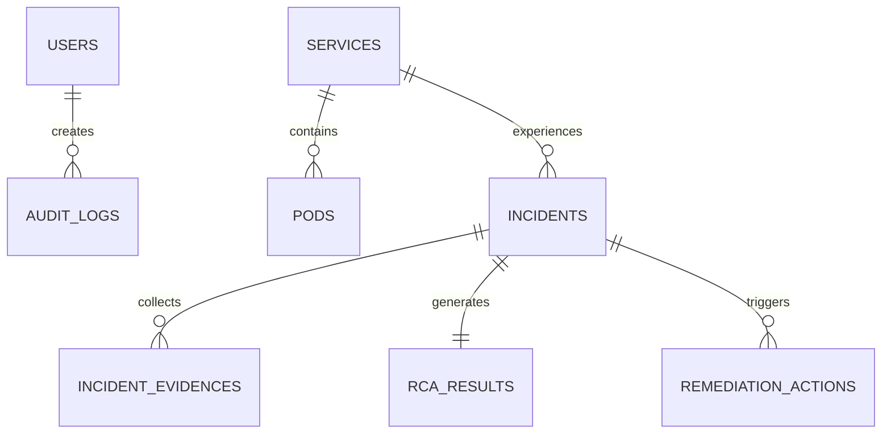

### Diagram 16: Database Architecture
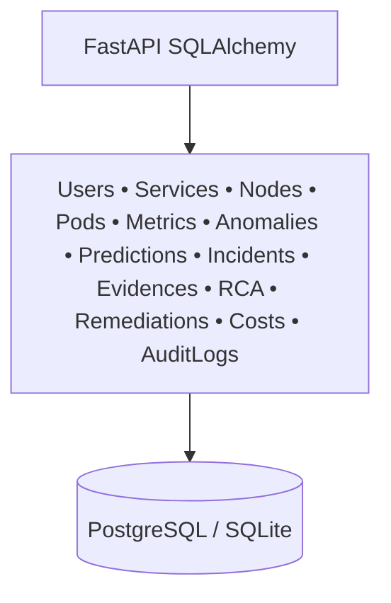

### Diagram 17: Incident Lifecycle State Machine
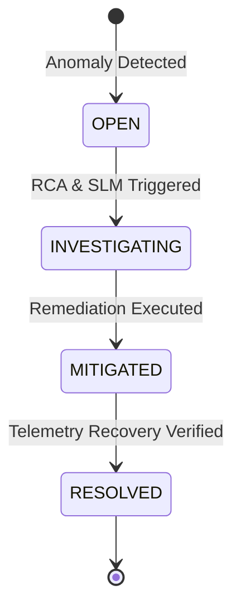

### Diagram 18: End-to-End Sequence Diagram
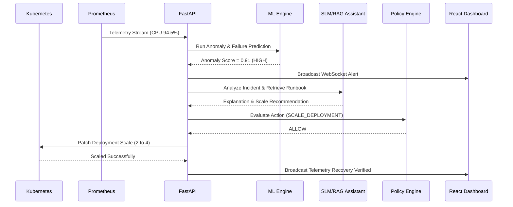
